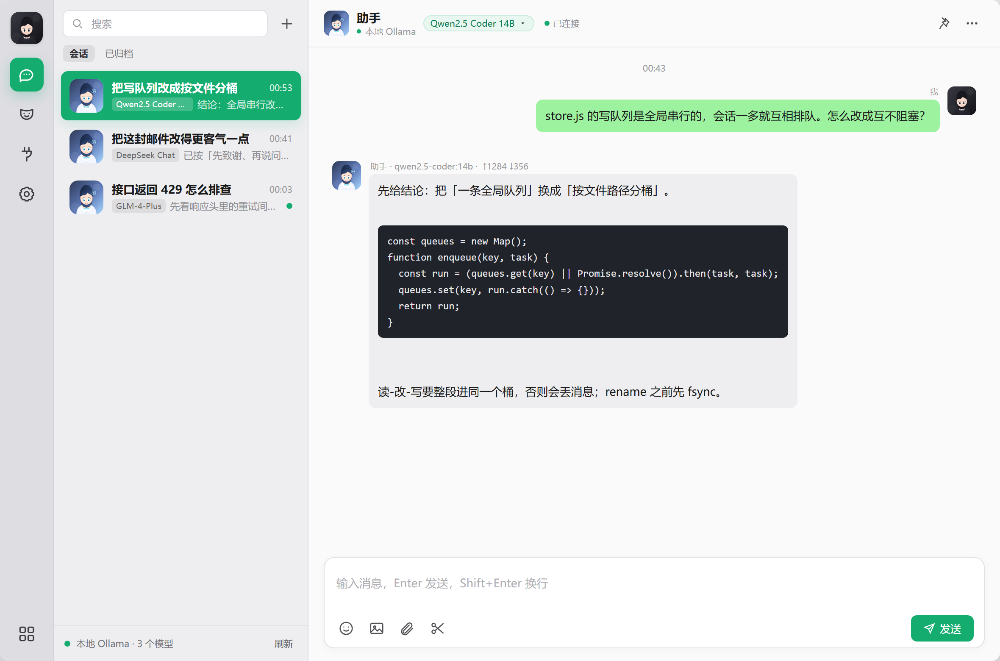
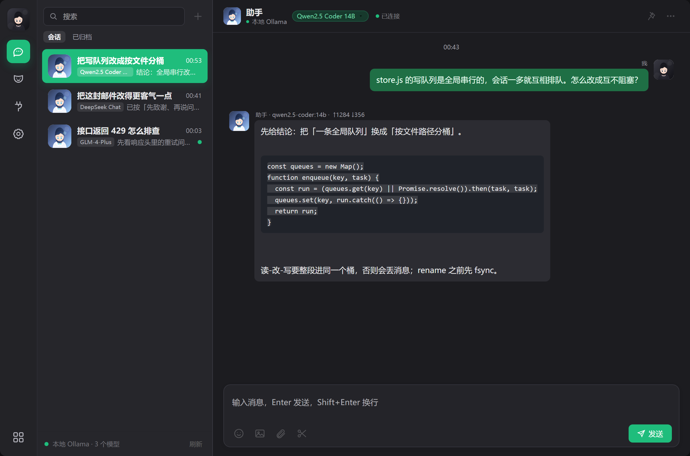
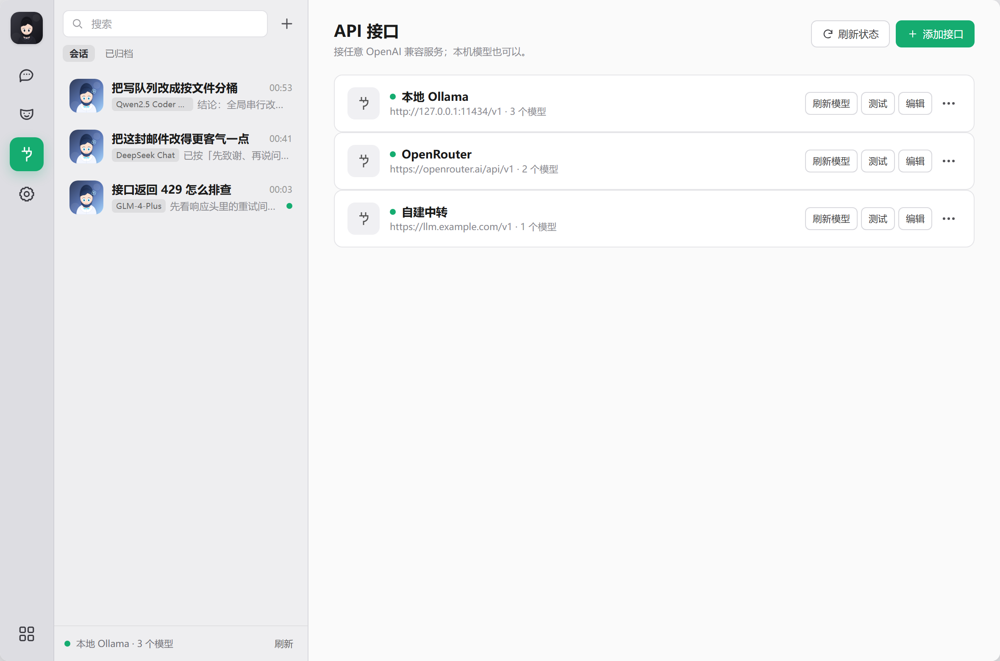
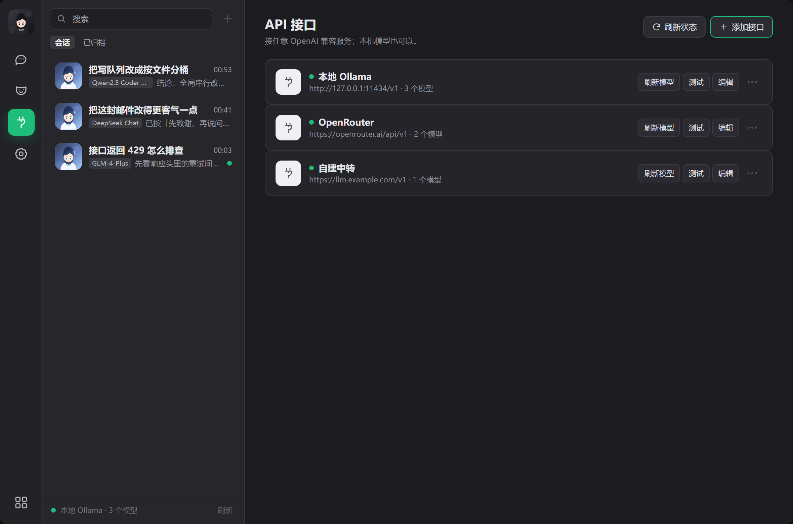

<p align="center">
  
</p>

<h1 align="center">OwnChat</h1>

<p align="center">
  <b>One window for every model. Local-first, no account, no telemetry.</b><br>
  Each conversation keeps its own provider, model and persona.
</p>

<p align="center">
  <a href="https://github.com/KovacBro/OwnChat/releases/latest"></a>
  <a href="LICENSE"></a>
  
  
</p>

<p align="center">
  <a href="README.zh-CN.md">中文说明</a> ·
  <a href="#install">Install</a> ·
  <a href="#bring-your-own-model">Providers</a> ·
  <a href="#faq">FAQ</a> ·
  <a href="ROADMAP.md">Roadmap</a>
</p>

---

## What it is

OwnChat is a Windows desktop chat client for people who already use more than one
AI model. Open a conversation, pin it to a provider, model and persona — and
switch models a hundred times without losing a single message.

It runs entirely on your machine: a small local server on `127.0.0.1`, your API
keys encrypted at rest, and no cloud account of any kind.

## Why people use it

**One window, every model.** 求索 (DeepSeek), 百炼 (Qwen), 方舟 (Doubao),
OpenRouter, Gemini, Groq, SiliconFlow, Zhipu, ModelScope, Mistral, Cerebras,
GitHub Models, Azure OpenAI, a local Ollama — or any OpenAI-compatible endpoint.
Each conversation remembers its own `provider + model + persona`, so a coding
chat and a translation chat never interfere.

**Genuinely local.** No telemetry, no analytics, no sign-in. Keys are encrypted
with AES-256-GCM and never returned to the browser. The HTTP server binds to
`127.0.0.1` only.

**Light on the machine.** No bundled Electron runtime — OwnChat uses the Edge
engine already installed on Windows and opens as a frameless app window. The
whole thing is plain Node and vanilla JS, with zero npm dependencies.

**Yours to audit.** AGPL-3.0. Read the proxy, read the storage layer, fork it if
you disagree with a design decision.

## Status

`0.2.x` is an early release. The data format may still change before `1.0.0`;
export your workspace before upgrading across minor versions. Windows only for
now. The installer is not code-signed yet — see [FAQ](#faq).

## Install

### Windows installer (recommended)

1. Open **[Releases](https://github.com/KovacBro/OwnChat/releases/latest)**.
2. Download `OwnChat-<version>-win64-setup.exe`.
3. Run it. Per-user install into `%LOCALAPPDATA%\Programs\OwnChat`; no admin
   rights needed.
4. Launch **OwnChat** from the Start Menu.

The installer bundles Node.js — you do not need a separate Node installation.

### Portable ZIP

Download `OwnChat-<version>-win64-portable.zip`, extract, run `start.bat`
(or `start.vbs` for a hidden launcher).

### From source

```powershell
git clone https://github.com/KovacBro/OwnChat.git
cd OwnChat
node server.js
```

Requires Node.js 22+ and Microsoft Edge. `start.bat` starts the server and opens
the Edge app window.

## Bring your own model

OwnChat ships with no keys and no quota. You point it at a provider you already
pay for, or at a free tier you registered yourself.

| Provider | Base URL | Key |
|---|---|---|
| **求索** (DeepSeek) | `https://api.deepseek.com/v1` | Required |
| **百炼** (Alibaba Bailian) | `https://dashscope.aliyuncs.com/compatible-mode/v1` | Required |
| **方舟** (Volcengine Ark) | `https://ark.cn-beijing.volces.com/api/v3` | Required |
| OpenRouter | `https://openrouter.ai/api/v1` | Required |
| Google Gemini | `https://generativelanguage.googleapis.com/v1beta/openai/` | Required |
| Groq | `https://api.groq.com/openai/v1` | Required |
| SiliconFlow | `https://api.siliconflow.cn/v1` | Required |
| Zhipu BigModel | `https://open.bigmodel.cn/api/paas/v4` | Required |
| ModelScope | `https://api-inference.modelscope.cn/v1` | Required |
| Mistral | `https://api.mistral.ai/v1` | Required |
| Cerebras | `https://api.cerebras.ai/v1` | Required |
| GitHub Models | `https://models.github.ai/inference` | GitHub token |
| Ollama (local) | `http://127.0.0.1:11434/v1` | None |
| Custom / Azure | any OpenAI-compatible URL | Optional |

Every provider card exposes the full request surface when you need it: context
window, max output, temperature, Top P, custom headers and body, timeout, vision
capability, test-connection and model discovery.

### The three domestic presets

They sit outside the persona system — no avatar, no character prompt — and each
opens a conversation with the plain assistant in one click.

| Preset | What it is for | Notes |
|---|---|---|
| **求索** | General chat, writing, translation | DeepSeek's official API, `deepseek-chat` / `deepseek-reasoner` |
| **百炼** | Long documents, images, enterprise calls | The Qwen family: `qwen-plus`, `qwen-max`, `qwen-vl` |
| **方舟** | Doubao models, role-play, voice | Create an inference endpoint in the Ark console; the model name is the `ep-…` ID |

Free tiers and model IDs change constantly. OwnChat does not bundle any keys and
does not promise unlimited free usage.

## Privacy

```text
data/
  index.json               settings, providers, personas, conversation index
  conversations/<id>.json  messages per conversation
  uploads/                 chat images
  avatars/                 generated / uploaded avatars
  .master-key              per-install AES-256-GCM key
  edge-profile/            Edge app profile
```

- API keys are encrypted at rest; the frontend only ever receives `hasKey`.
- Export excludes API keys.
- No cloud sync, no telemetry, no crash reporting.
- Local application-level encryption is not a substitute for Windows Credential
  Manager against an administrator-level attacker.

Your prompts and replies go to the provider **you** configured, and nowhere
else. If you use an overseas endpoint, your data leaves your machine — that is
your choice to make, and the app does not hide it.

## Advanced: WorkBuddy integration

If you already run the WorkBuddy desktop app and the local
`dsh-connect-workbuddy` plugin, OwnChat can read that plugin's **existing local
credential vault** and reuse its model catalog. It does not create accounts, does
not proxy through our servers, and does not upload credentials anywhere.

OwnChat is not affiliated with WorkBuddy or Tencent and does not provide, resell
or share any third-party subscription, quota or account. Use it only with
accounts you are entitled to use, under that vendor's terms.

## Enterprise and private deployment

OwnChat is a single-process local app, which makes it easy to run inside a
network that has no route to the public internet: point it at an intranet
OpenAI-compatible gateway or a local Ollama, and the chat data never leaves the
machine.

The team build (policy-controlled providers, shared persona packs, audit logs,
offline model management) is in progress. If you are evaluating OwnChat for an
organisation, open a discussion or mail the address in the repo profile.

## Screenshots

| Light | Dark |
|---|---|
|  |  |
|  |  |

More: [`docs/assets/shots/`](docs/assets/shots) — personas and settings, light and dark.

## Known limitations

- Voice is not in the roadmap.
- File and screenshot sending are not available yet.
- Very long conversations render in one pass; 1,000+ messages may feel slow.
- Anthropic Messages and Gemini native protocols are not implemented; use
  OpenRouter or an OpenAI-compatible gateway for Claude.
- WorkBuddy multi-account auto-rotation is not exposed yet.
- The installer is unsigned; verify checksums.

Upgrading keeps `data/`. Uninstalling keeps it too — the uninstaller only
removes the app files and the Edge profile. Delete `data/` by hand for a clean
wipe.

## FAQ

**Do I need an account?** No. There is no sign-up, no login, no device limit.

**How do I open it, and how do I quit?** Launch it from the Start Menu or the
desktop shortcut. Closing the window stops the local server after a few seconds.
If you want it to stay up in the background, enable “关窗口后继续后台运行” in
Settings and reopen it from the same shortcut. Two launches never start two
servers — the second one reuses the first.

**Where does my data go?** Nowhere except the provider you configure. See
[Privacy](#privacy).

**Is it code-signed?** Not yet. Windows SmartScreen may say "Unknown publisher";
verify `SHA256SUMS.txt` from the release assets before installing. Code signing
is planned for `1.0.0`.

**Does it work offline?** Yes, with Ollama or any local OpenAI-compatible server.

**Why AGPL-3.0?** So that improvements to a hosted or resold version come back
to users. Personal use, modification and self-hosting are unaffected.

**macOS or Linux?** Not planned yet. The local server is portable; the app shell
is Windows-first.

## Roadmap

See [ROADMAP.md](ROADMAP.md). `0.2.0` (2026-10-22) added the reliability pass:
account/region UX, per-model capabilities, retry with diagnostics, search,
archive, export/import, dark theme, and data-preserving upgrades. `0.3.0` moves
on to attachments and richer chat.

Voice is **not** in the roadmap.

## Contributing

Bug reports and pull requests are welcome — please read
[CONTRIBUTING.md](.github/CONTRIBUTING.md) first. For security issues, see
[SECURITY.md](.github/SECURITY.md).

## License

[AGPL-3.0-or-later](LICENSE) © 2026 KovacBro.

Versions up to and including `v0.1.0` were released under the MIT license; that
grant is irrevocable and remains in force for those tags. Starting with `0.2.0`,
the project is licensed under AGPL-3.0.

OwnChat is not affiliated with WorkBuddy, Tencent, DeepSeek, Zhipu, or any model
provider. Third-party names are trademarks of their respective owners.

<!-- TODO(marketing): replace the hero screenshot with one that does not show a
     vendor-branded provider, and add a 10-second demo GIF below. -->
