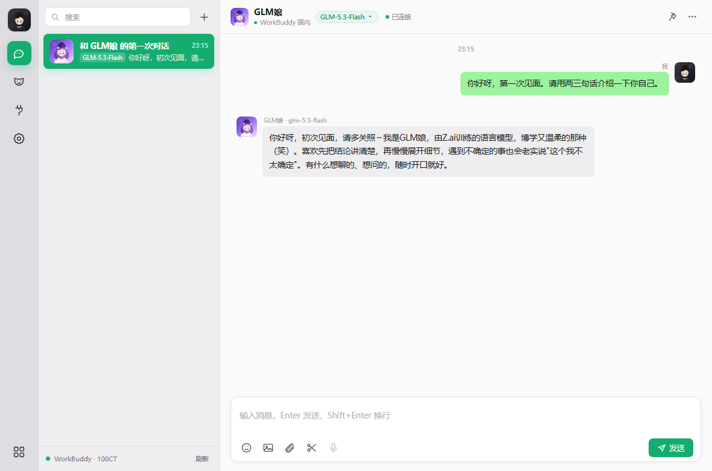
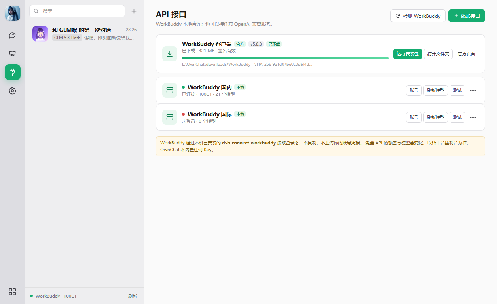

<p align="center">
  
</p>

<h1 align="center">OwnChat</h1>

<p align="center">
  <b>本地优先、多模型、多聊天窗的 Windows 桌面 AI 聊天客户端。</b><br>
  每个聊天窗独立绑定接口、模型与人格；整体布局参考 WorkBuddy，聊天体验参考微信。
</p>

<p align="center">
  <a href="https://github.com/KovacBro/OwnChat/releases/latest"></a>
  
  
  <a href="LICENSE"></a>
</p>

---

## Highlights

- **Three-column desktop UI** — icon rail, conversation list, and chat area, designed for Edge `--app` windows.
- **One model per conversation** — each chat stores its own `Provider + Model + Persona`; switching does not disturb other conversations.
- **Real WorkBuddy integration** — reuses the local `dsh-connect-workbuddy` credential store, token refresh, model catalog, and upstream SSE protocol. No 8787 gateway.
- **Bring your own models** — OpenAI-compatible and Azure OpenAI endpoints, with presets for OpenRouter, Gemini, Groq, SiliconFlow, Zhipu, ModelScope, Mistral, Cerebras, GitHub Models, and Ollama.
- **Real streaming chat** — stream, stop, retry, copy, collapsible reasoning, Markdown code blocks, and clear provider errors.
- **Text, Emoji, and images** — up to four images per message, compressed locally; vision capability is checked before sending.
- **Personas and avatars** — DeepSeek娘, GLM娘, Hy3娘, plus a generic persona. Avatar Studio supports preset prompts, custom prompts, uploads, and optional image APIs.
- **WorkBuddy download center** — official Windows installer, pause/resume, SHA-256, and Authenticode verification.
- **Local-first** — no cloud account, no telemetry, API keys encrypted with AES-256-GCM, server bound to `127.0.0.1`.

## Install

### Windows installer (recommended)

1. Open **[Releases](https://github.com/KovacBro/OwnChat/releases/latest)**.
2. Download `OwnChat-<version>-win64-setup.exe`.
3. Run it. The installer is per-user (`%LOCALAPPDATA%\Programs\OwnChat`) and does not need admin rights.
4. Launch **OwnChat** from the Start Menu or desktop shortcut.

The installer bundles Node.js; you do not need a separate Node installation.

### Portable ZIP

Download `OwnChat-<version>-win64-portable.zip`, extract it, and run `start.bat`
(or `start.vbs` for a hidden launcher).

### From source

```powershell
git clone https://github.com/KovacBro/OwnChat.git
cd OwnChat
node server.js
```

Requires Node.js 22+ and Microsoft Edge. `start.bat` starts the server and
opens the Edge app window.

> The OwnChat installer is not code-signed yet. Windows SmartScreen may show
> “Unknown publisher”. Verify `SHA256SUMS.txt` from the release assets.

## WorkBuddy

OwnChat does **not** reimplement WorkBuddy login. It reuses the local
[`dsh-connect-workbuddy`](https://github.com/dingminhua/dsh-connect-workbuddy)
plugin already installed in the DSH desktop profile:

- reads the plugin's local CN / Global credential vault;
- reuses its token refresh;
- reads the same `/v3/config` model catalog;
- speaks the same upstream `/v2/chat/completions` protocol.

Requirements:

- WorkBuddy desktop app installed and signed in;
- `dsh-connect-workbuddy` installed in the DSH desktop profile.

If the plugin is missing, OwnChat still runs with free or custom providers.
The **API 接口** page shows the WorkBuddy connection status and account.

## Providers

The **API 接口** page supports:

- OpenAI Chat Completions
- Azure OpenAI
- Custom Base URL, API Key, model, organization, API version, deployment
- Context window, max output, temperature, Top P
- Custom request headers and body
- Timeout, enabled toggle, vision toggle
- Test connection and model discovery

Built-in presets:

| Provider | Base URL | Key |
|---|---|---|
| OpenRouter | `https://openrouter.ai/api/v1` | Required |
| Google Gemini | `https://generativelanguage.googleapis.com/v1beta/openai/` | Required |
| Groq | `https://api.groq.com/openai/v1` | Required |
| SiliconFlow | `https://api.siliconflow.cn/v1` | Required |
| Zhipu BigModel | `https://open.bigmodel.cn/api/paas/v4` | Required |
| ModelScope | `https://api-inference.modelscope.cn/v1` | Required |
| Mistral | `https://api.mistral.ai/v1` | Required |
| Cerebras | `https://api.cerebras.ai/v1` | Required |
| GitHub Models | `https://models.github.ai/inference` | GitHub token |
| Ollama | `http://127.0.0.1:11434/v1` | None |

Free tiers and model IDs change; check each provider's console. OwnChat does
not bundle any API keys.

## WorkBuddy download center

The **API 接口** page includes a **WorkBuddy 客户端** card:

- official Windows x64 installer, version 5.8.3, about 421 MB;
- downloads to `downloads/WorkBuddy/` under the app directory;
- pause / resume / progress / speed / ETA;
- SHA-256 and Windows Authenticode signature verification;
- open folder, run installer, or open the official download page.



## Versioning and releases

OwnChat follows SemVer.

- **Only `MAJOR.MINOR.0` receives installer assets** — `0.1.0`, `0.2.0`, …, `1.0.0`.
- Patch releases (`0.2.1`, …) are source-only tags. They do not receive installers.
- Old releases are never deleted or overwritten.
- Every minor release is published on GitHub Releases; the repository sidebar points to the latest minor.

See [CHANGELOG.md](CHANGELOG.md) for released versions and
[docs/RELEASING.md](docs/RELEASING.md) for the release checklist.

## Roadmap

- [0.2.0 — Reliable daily driver](ROADMAP.md)
- [0.2.0 milestone and issues](https://github.com/KovacBro/OwnChat/milestone/1)
- Later: attachments, workflows, parallel generation, stable 1.0.

0.2.0 focuses on WorkBuddy account/region UX, per-model capabilities,
retry/error reliability, conversation search/export, dark theme, and
data-preserving installer upgrades.

Voice is **not** in the roadmap.

## Architecture

```text
server.js                 local HTTP server, API proxy, SSE
lib/store.js              JSON storage, AES-GCM, seed data
lib/workbuddy.js          dsh-connect-workbuddy adapter
lib/openai.js             generic OpenAI-compatible provider
lib/downloads.js          WorkBuddy downloader + signature check
public/index.html         three-column UI shell
public/styles.css         visual system
public/app.js             chat, streaming, personas, avatar studio
installer/OwnChat.iss     Inno Setup installer
```

The server binds to `127.0.0.1` only. The renderer talks to local `/api/*`
routes; provider keys never reach the browser. Data is stored under `data/`;
downloaded installers live under `downloads/`.

## Development

```powershell
node server.js          # http://127.0.0.1:17321
npm start               # same, and opens an Edge app window
```

No npm dependencies; Node built-ins only.

Build release assets:

```powershell
powershell -File installer/build-release.ps1 -Version 0.1.0
```

Outputs to `dist/`:

- `OwnChat-<version>-win64-setup.exe`
- `OwnChat-<version>-win64-portable.zip`
- `SHA256SUMS.txt`

## Data and security

```text
data/
  index.json               settings, providers, personas, conversation index
  conversations/<id>.json  messages per conversation
  uploads/                 chat images
  avatars/                 generated / uploaded avatars
  .master-key              per-install AES-256-GCM key
  edge-profile/            Edge app profile
downloads/WorkBuddy/       downloaded WorkBuddy installer + meta.json
```

- API keys are encrypted at rest; the frontend only receives `hasKey`.
- Export excludes API keys.
- No cloud sync, no telemetry.
- Local application-level encryption is not a substitute for Windows
  Credential Manager against an administrator-level attacker.

## Known limitations

- Light theme only (dark theme planned for 0.2.0).
- Voice is not in the roadmap.
- File and screenshot sending are not available yet.
- Anthropic Messages and Gemini native protocols are not implemented; use
  OpenRouter or an OpenAI-compatible gateway for Claude.
- WorkBuddy multi-account auto-rotation is not exposed yet.
- The installer is unsigned; verify checksums.

## License

[MIT](LICENSE) © 2026 KovacBro

OwnChat is not affiliated with WorkBuddy, Tencent, DeepSeek, Zhipu, or any
model provider. Third-party names are trademarks of their respective owners.
