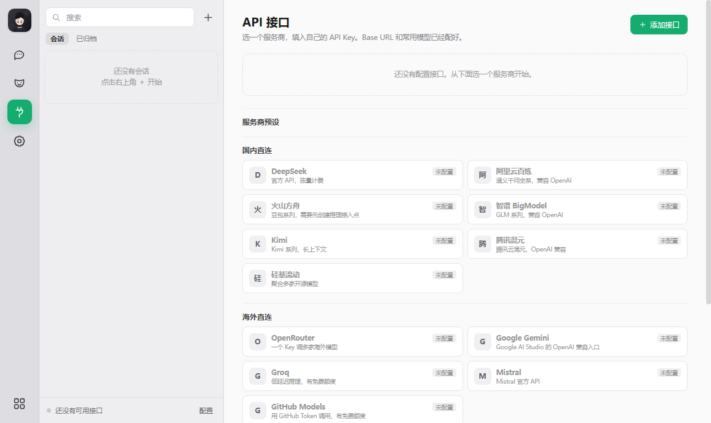
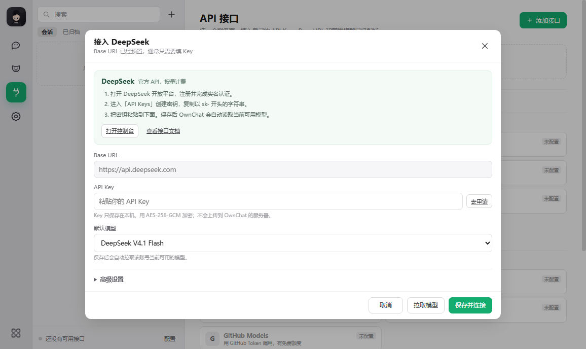

<p align="center">
  
</p>

<h1 align="center">OwnChat</h1>

<p align="center">
  <b>一个窗口，管住你所有的 AI 模型。本地优先 · 无需注册 · 零遥测。</b><br>
  每个会话独立绑定自己的接口、模型与人格。
</p>

<p align="center">
  <a href="https://github.com/KovacBro/OwnChat/releases/latest"></a>
  <a href="LICENSE"></a>
  
</p>

<p align="center">
  <a href="README.md">English</a> ·
  <a href="#安装">安装</a> ·
  <a href="#接上你自己的模型">接口配置</a> ·
  <a href="#隐私与边界">隐私与边界</a> ·
  <a href="#常见问题">常见问题</a>
</p>

---

## 这是什么

OwnChat 是一个面向 Windows 的桌面 AI 聊天客户端，给那些**本来就同时用好几家模型**的人用。
新建一个会话，绑定一个接口、一个模型、一个人格；之后随便切换模型，历史一条都不会乱。

它完全跑在你自己的机器上：本地只监听 `127.0.0.1`，API Key 加密落盘，不需要任何云端账号。

## 0.2.3 的变化

- **接口页改成服务商预设。** 选一个服务商，Base URL、协议和常用模型已经填好，你只需要准备自己的 API Key。
- **每个预设都有接入步骤。** 表单里直接给出控制台入口、文档入口和 3–4 步操作说明，不需要先去别处找教程。
- **去掉旧版本中依赖本机第三方客户端凭据的接入方式。** 现在只连接你自己配置的 OpenAI 兼容接口，不读取其他应用的登录态。
- **本地 API 加了会话令牌。** 服务仍然只绑定 `127.0.0.1`，同时校验 `Origin`/`Host` 和 JSON 请求类型，降低本机网页伪造请求的风险。
- **修复了补丁版的升级路径。** 覆盖安装保留 `data/`；旧数据里已经失效的接口和模型绑定会在启动时自动清理。

完整说明见 [`docs/releases/0.2.3.md`](docs/releases/0.2.3.md)。

## 为什么用它

**一个窗口管所有模型。** DeepSeek、阿里云百炼、火山方舟、智谱 BigModel、Kimi、腾讯混元、
硅基流动、OpenRouter、Google Gemini、Groq、Mistral、GitHub Models、Azure OpenAI，
或者本机 Ollama / 任意 OpenAI 兼容地址。每个会话各自记住 `接口 + 模型 + 人格`。

**真的本地。** 没有账号、没有埋点、没有崩溃上报。Key 用 AES-256-GCM 加密，
前端永远只拿到 `hasKey`。HTTP 服务只绑定 `127.0.0.1`，状态变更接口还需要本次启动生成的令牌。

**很轻。** 不打包 Electron 运行时，直接用 Windows 上已有的 Edge 引擎开一个无边框应用窗口。
纯原生 JS，零 npm 依赖。

**可以自己查。** AGPL-3.0，代理层和存储层都摊开给你看，不认同某个设计就直接 fork。

## 当前状态

`0.2.x` 是早期版本，数据格式在 `1.0.0` 之前仍可能调整，跨小版本升级前请先导出。
目前只支持 Windows。安装包**暂未做代码签名**，首次运行可能出现“未知发布者”提示，
请核对 Release 里的 `SHA256SUMS.txt`。

覆盖安装会保留 `data/`；**卸载也不会删除 `data/`**，想彻底清空请手动删除该目录。

## 安装

### Windows 安装包（推荐）

1. 打开 **[Releases](https://github.com/KovacBro/OwnChat/releases/latest)**；
2. 下载 `OwnChat-<版本>-win64-setup.exe`；
3. 双击安装，装到 `%LOCALAPPDATA%\Programs\OwnChat`，不需要管理员权限；
4. 从开始菜单启动 **OwnChat**。

安装包已内置 Node.js，不用另外装环境。

### 便携版

下载 `OwnChat-<版本>-win64-portable.zip`，解压后运行 `start.bat`
（或 `start.vbs`，无黑框启动）。

### 从源码运行

```powershell
git clone https://github.com/KovacBro/OwnChat.git
cd OwnChat
node server.js
```

需要 Node.js 22+ 和 Microsoft Edge。

## 接上你自己的模型

OwnChat **不带任何 Key，也不提供额度**。你接自己已经付费的接口，或者自己注册的免费额度。

打开「API 接口」，选一个预设，填 Key，点「保存并连接」。Base URL 已经填好，通常不需要改。
保存后 OwnChat 会调用该服务的 `/models` 接口，把当前账号可用的模型读回来。

<p align="center">
  
</p>

### 内置预设

| 服务商 | 预置 Base URL | Key |
|---|---|---|
| **DeepSeek** | `https://api.deepseek.com` | 需要 |
| **阿里云百炼** | `https://dashscope.aliyuncs.com/compatible-mode/v1` | 需要 |
| **火山方舟** | `https://ark.cn-beijing.volces.com/api/v3` | 需要 + 接入点 ID |
| **智谱 BigModel** | `https://open.bigmodel.cn/api/paas/v4` | 需要 |
| **Kimi** | `https://api.moonshot.cn/v1` | 需要 |
| **腾讯混元** | `https://api.hunyuan.cloud.tencent.com/v1` | 需要 |
| **硅基流动** | `https://api.siliconflow.cn/v1` | 需要 |
| **OpenRouter** | `https://openrouter.ai/api/v1` | 需要 |
| **Google Gemini** | `https://generativelanguage.googleapis.com/v1beta/openai/` | 需要 |
| **Groq** | `https://api.groq.com/openai/v1` | 需要 |
| **Mistral** | `https://api.mistral.ai/v1` | 需要 |
| **GitHub Models** | `https://models.github.ai/inference` | GitHub Token |
| **Ollama（本地）** | `http://127.0.0.1:11434/v1` | 不需要 |
| **Azure OpenAI** | 你的资源 Endpoint | 需要 + 部署名 |
| **自定义接口** | 任意 OpenAI 兼容地址 | 可选 |

每个预设的表单里都写了对应的申请步骤，并提供「打开控制台」「查看接口文档」两个入口。
如果某个平台临时改了模型名，保存后点一次「刷新模型」即可，不需要改代码。

### 预设之外

- **火山方舟**：先去控制台创建推理接入点，模型 ID 填 `ep-` 开头的那一串；这一步无法省略。
- **GitHub Models**：用 fine-grained token，只给 Models 读取权限，不要顺手勾仓库权限。
- **Ollama**：先装 Ollama，再 `ollama pull qwen3:8b`，确认本机服务在 `11434` 端口。
- **Azure OpenAI**：在「高级设置」里填 Endpoint、API Key、部署名和 API 版本。
- **任何兼容服务**：选「自定义接口」，填 Base URL；有 Key 就填，没有就留空。

每个接口卡片还能展开完整参数：上下文窗口、最大输出、温度、Top P、自定义请求头与请求体、
超时、视觉能力开关、测试连接、拉取模型列表。

免费额度和模型 ID 变化很快，以各家控制台为准。OwnChat 不内置任何 Key，也不承诺“永久免费”。

## 本地数据

```text
data/
  index.json               设置、接口、人格、会话索引
  conversations/<id>.json  每个会话的消息
  uploads/                 聊天图片
  avatars/                 生成或上传的头像
  .master-key              本机随机密钥（AES-256-GCM）
  edge-profile/            Edge 应用窗口的用户目录
```

- API Key 加密存储；前端只拿 `hasKey`，不拿明文；
- 导出默认不含 Key；
- 无云同步、无遥测、无崩溃上报；
- 本地服务只监听 `127.0.0.1`；API 需要本次启动生成的会话令牌，并校验 `Origin`/`Host`；
- 本地应用层加密不能替代 Windows 凭据管理器，无法防御管理员级攻击者。

你的提问和回答只会发往**你自己配置的接口**。如果用境外端点，数据会离开你的机器——
这是你自己的选择，App 不会替你做决定，也不会隐瞒。

## 隐私与边界

OwnChat 只做一件事：把你输入的内容发到你亲手配置的模型接口，再把回复取回来。

- **不提供、不转售、不共享**任何第三方账号、订阅、额度或 API Key；
- **不读取**其他应用的登录凭据，也不依赖任何第三方客户端才能工作；
- 你只能使用自己合法持有的 Key，并遵守对应服务商的服务条款、计费规则和地区限制；
- 各服务商如何处理你的输入、是否用于训练、数据存放在哪个地区，由你和该服务商之间的协议决定；
- OwnChat 与 DeepSeek、阿里云、火山引擎、智谱、月之暗面、腾讯、OpenRouter、Google、
  Groq、Mistral、GitHub、Microsoft 等公司均无隶属关系，也未获其背书；
- 文中出现的第三方名称仅用于说明兼容关系，商标权利归各自权利人所有。

如果你在企业内使用，请先确认：账号归属、数据处理协议、跨境传输、员工告知和保密要求。
OwnChat 是本地工具，不替你完成这些组织层面的合规义务。

## 企业 / 私有化

OwnChat 是单进程本地应用，天然适合没有外网出口的内网环境：指向内网的 OpenAI 兼容网关或本地
Ollama 即可，聊天数据不出机器。

团队版（统一策略管控、人格包下发、审计日志、离线模型管理）在开发中。
如果要在组织内评估 OwnChat，可以开一个 Discussion，或发邮件到仓库主页的地址。

## 截图

| 接口页 | 接入表单 |
|---|---|
|  |  |

## 常见问题

**要注册账号吗？** 不用。没有登录、没有设备数限制。

**我的数据去哪了？** 只去你自己配置的接口，见[本地数据](#本地数据)和[隐私与边界](#隐私与边界)。

**Key 会被上传吗？** 不会上传到 OwnChat 的服务器。Key 只在本机加密保存，请求时直接发给你选的服务商。

**有代码签名吗？** 还没有。SmartScreen 可能提示“未知发布者”，请核对 `SHA256SUMS.txt`。
签名计划在 `1.0.0` 做。

**断网能用吗？** 能，配合 Ollama 或任何本地 OpenAI 兼容服务。

**为什么用 AGPL？** 防止有人拿它改一改就闭源转卖；个人使用、修改、自建都不受影响。

**有 Mac / Linux 版吗？** 暂时没有计划。本地服务本身是跨平台的，外层壳目前只做 Windows。

## 路线图

见 [ROADMAP.md](ROADMAP.md)。`0.2.3` 的主题是“去第三方依赖、把接口配置做简单”；
`0.3.0` 转向附件和更完整的聊天体验。

**语音不在路线图内。**

## 参与

欢迎提 Issue 和 PR，请先读 [CONTRIBUTING.md](.github/CONTRIBUTING.md)。
安全问题请看 [SECURITY.md](.github/SECURITY.md)。

## 许可

[AGPL-3.0-or-later](LICENSE) © 2026 KovacBro。

`v0.1.0` 及更早版本以 MIT 发布，该授权不可撤回，对这些 tag 继续有效；
自 `0.2.0` 起项目改用 AGPL-3.0。
